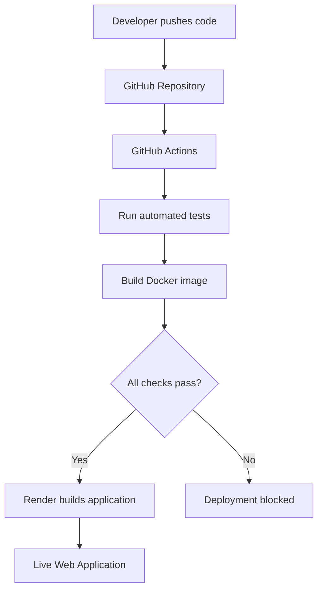

# Automated Deployment Pipeline

A beginner-friendly Cloud/DevOps project demonstrating automated testing, Docker containerisation, Continuous Integration (CI), and Continuous Deployment (CD).

**Live Application:** https://cloud-pipeline-demo-5ekk.onrender.com

**Repository:** https://github.com/OluSeyi27/automated-deployment-pipeline

## Project Overview

This project demonstrates how to automate the process of testing, building, and deploying a Node.js web application using GitHub Actions, Docker, and Render.

Whenever new code is pushed to the `main` branch, GitHub Actions runs automated tests and verifies that the Docker image builds successfully. Render waits for the CI checks to pass before automatically deploying the updated application.

## Technologies Used

- **Node.js** — Application runtime.
- **GitHub** — Source code management.
- **GitHub Actions** — CI automation.
- **Docker** — Application containerisation.
- **Render** — Cloud hosting and automated deployment.

## Architecture



## Application Features

- Homepage displaying application information.
- `/health` endpoint for application health checks.
- JSON responses for health monitoring.
- 404 responses for unknown routes.
- Automated application tests.
- Automated Docker image build verification.
- Deployment triggered after successful CI checks.

## Project Structure

```text
automated-deployment-pipeline/
│
├── .github/
│   └── workflows/
│       └── ci.yml
│
├── tests/
│   └── server.test.js
│
├── app.js
├── server.js
├── package.json
├── Dockerfile
├── .dockerignore
└── README.md
```

## Running Locally

Requirements: Node.js 20 or newer.

1. Clone the repository:

```bash
git clone https://github.com/OluSeyi27/automated-deployment-pipeline.git
```

2. Enter the project directory:

```bash
cd automated-deployment-pipeline
```

3. Run the application:

```bash
npm start
```

4. Open `http://localhost:3000` in your browser.

## Running Tests

Execute:

```bash
npm test
```

The tests verify the homepage, health endpoint, and unknown-route handling.

## Building with Docker

Build the Docker image:

```bash
docker build -t cloud-pipeline-demo .
```

Run the container:

```bash
docker run -p 3000:3000 cloud-pipeline-demo
```

Visit `http://localhost:3000` to access the application.

## Deployment

The application is hosted on Render using its Docker deployment environment.

Automatic deployment is configured to occur after GitHub Actions CI checks pass.

**Live URL:** https://cloud-pipeline-demo-5ekk.onrender.com

Note: The project uses Render's free instance, which may sleep after periods of inactivity.

## What I Learned

Through this project, I gained practical experience with:

- Git and GitHub repository management.
- Node.js application structure.
- Writing and running automated tests.
- GitHub Actions workflow configuration.
- Dockerfiles and container image builds.
- Cloud application deployment.
- CI/CD automation.
- Deployment safety checks.

## Future Improvements

- Publish Docker images to a container registry.
- Add application monitoring with Prometheus and Grafana.
- Add deployment notifications.
- Introduce infrastructure automation using Terraform.

---

**Project Status:** Successfully deployed and operational.
